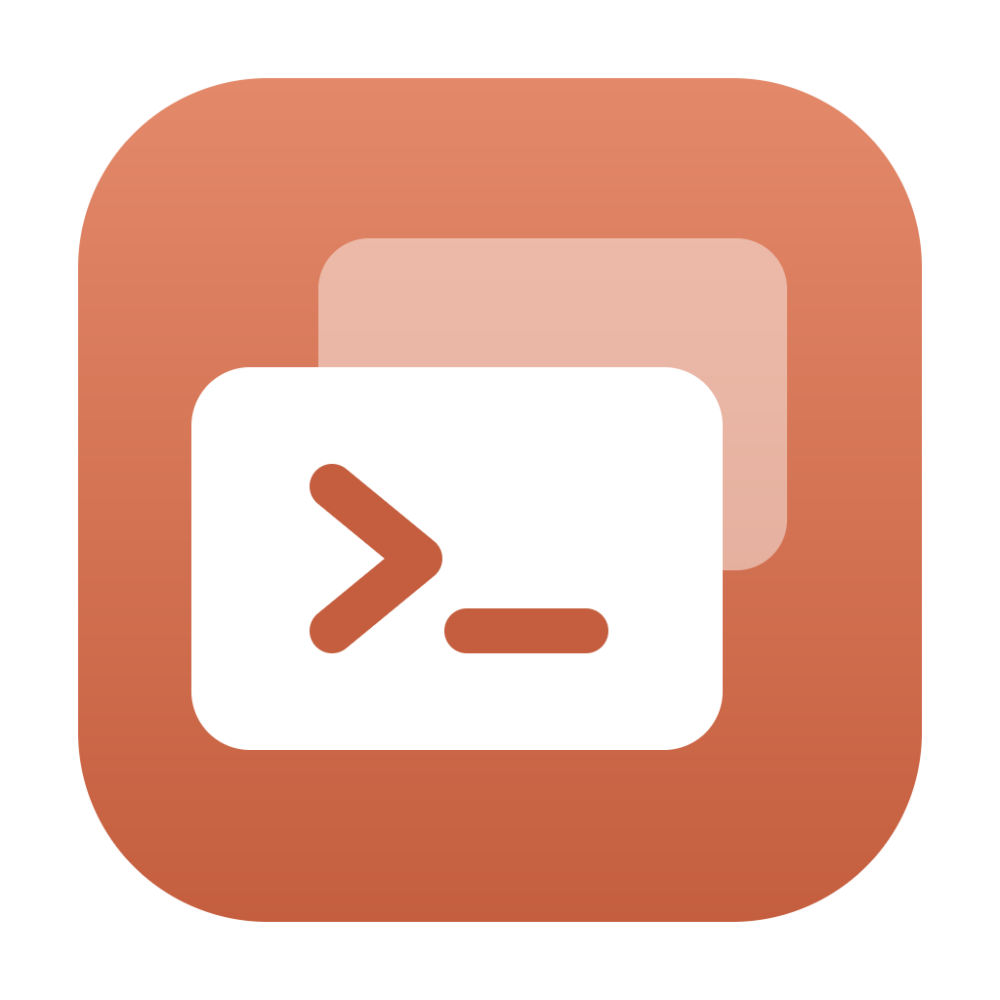
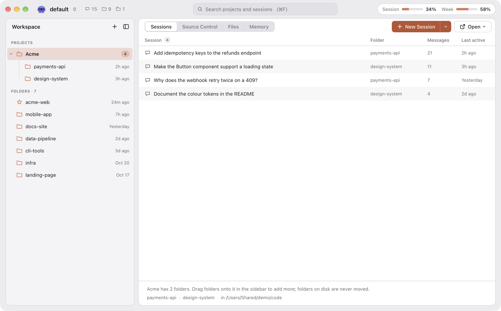
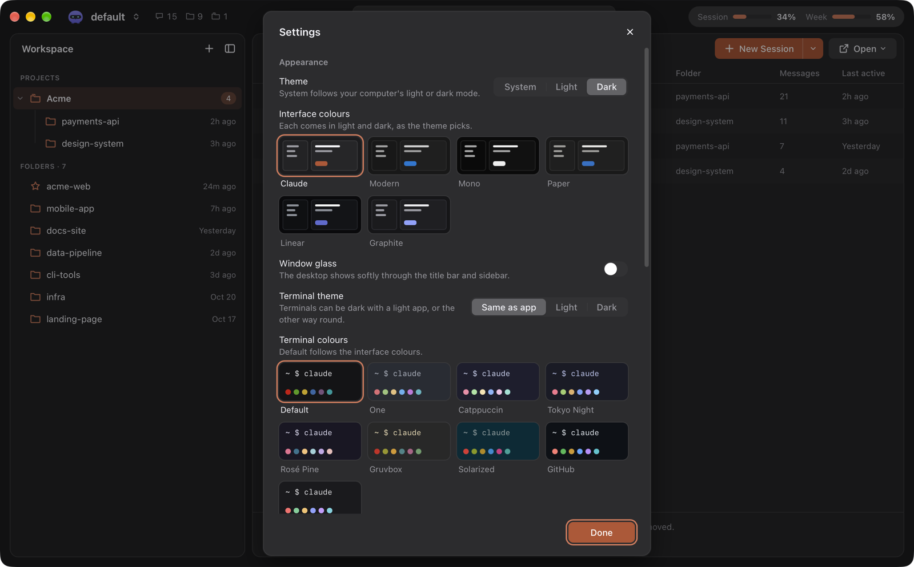
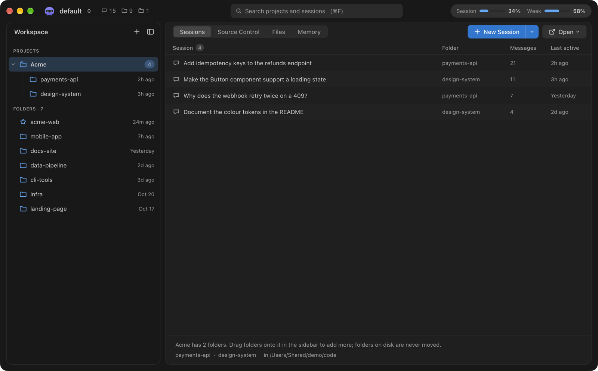
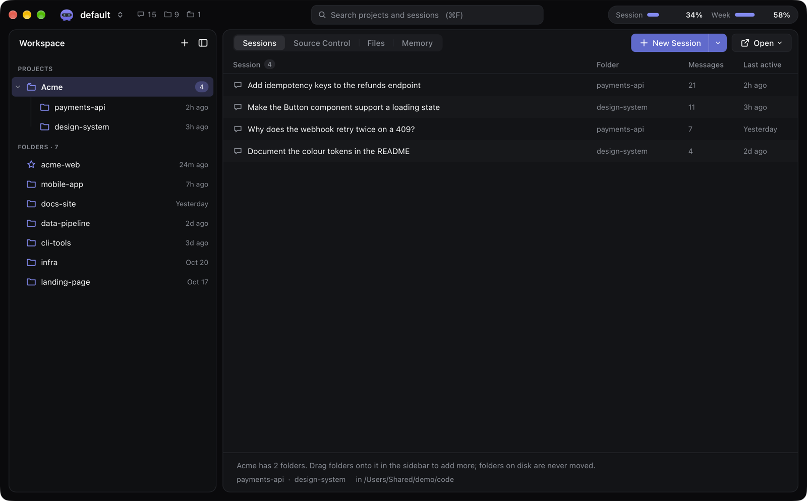
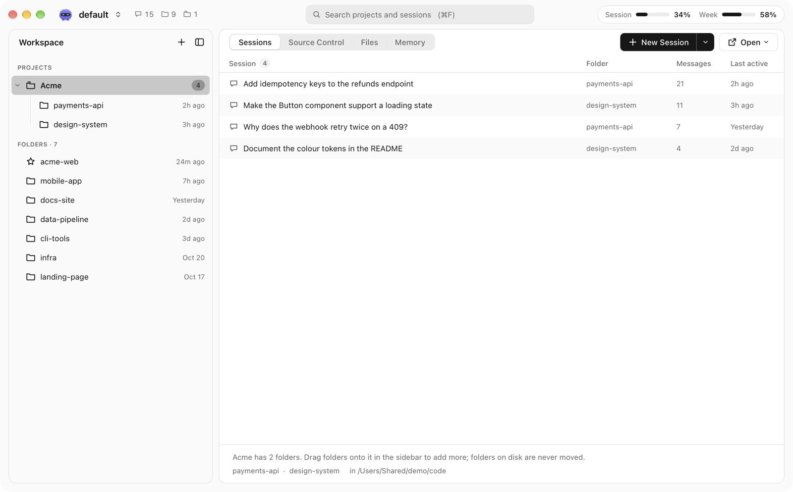
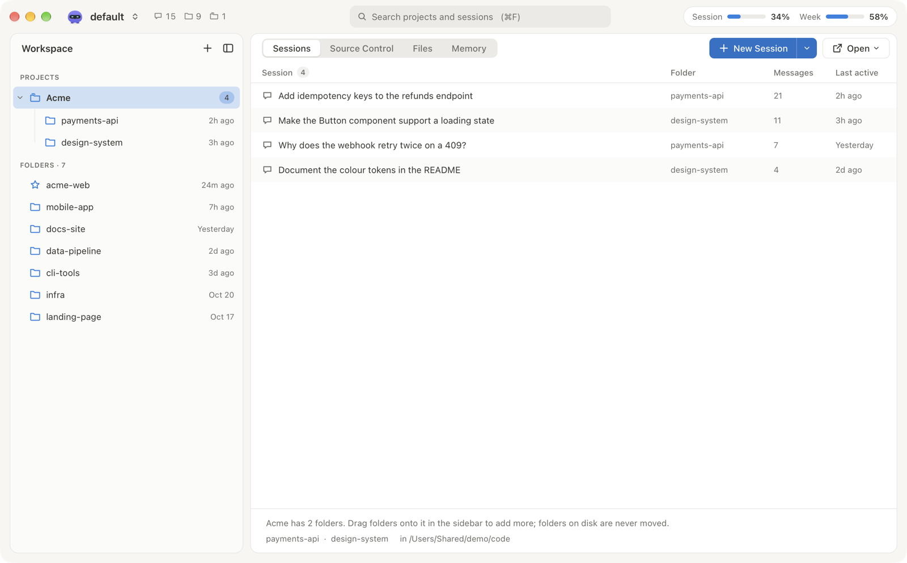

<br>

<p align="center"></p>

<h1 align="center">Claude Manager</h1>

<p align="center">Every Claude Code project, session and profile in one window.<br><strong>Start, resume and fork sessions in tabs</strong>, on Windows and macOS.</p>

<p align="center">
  <a href="https://github.com/xbuddhi/claude-manager/releases/latest"><picture><source media="(prefers-color-scheme: dark)" srcset="docs/readme/pill-download-dark.svg"></picture></a>
  <a href="#get-it"><picture><source media="(prefers-color-scheme: dark)" srcset="docs/readme/pill-macos-dark.svg"></picture></a>
  <a href="#get-it"><picture><source media="(prefers-color-scheme: dark)" srcset="docs/readme/pill-windows-dark.svg"></picture></a>
  <a href="LICENSE"><picture><source media="(prefers-color-scheme: dark)" srcset="docs/readme/pill-open-source-dark.svg"></picture></a>
  <a href="CHANGELOG.md"><picture><source media="(prefers-color-scheme: dark)" srcset="docs/readme/pill-changelog-dark.svg"></picture></a>
</p>

<br>

<picture>
  <source media="(prefers-color-scheme: dark)" srcset="docs/readme/mac-dark.png">
  
</picture>

## What it does

Claude Manager reads `~/.claude` and every `~/.claude-*` profile and runs `claude` in tabs on a real terminal
(ConPTY on Windows, a pseudo-terminal on macOS).

- **Every session, sorted by folder.** Projects, folders and sessions from all your profiles, searchable, with
  pinning, projects (groups) of folders, hidden folders and archived sessions.
- **Start, resume, fork.** In a tab, in a new window or in Terminal / iTerm / PowerShell. Rename a session like
  `/rename` does.
- **See what's working.** Live and busy sessions are marked as they run.
- **Profiles.** Switch between `~/.claude` and `~/.claude-*` from the title bar, add, rename or hide one; each
  has its own little companion as an avatar.
- **Source control.** Changes, coloured diffs (inline or side by side), a compact history graph, branch search,
  commit messages written by Claude, and the repository page on GitHub one click away.
- **Files.** Browse and open a folder's files beside the sessions, and side panels next to a terminal.
- **Memory.** The `CLAUDE.md` files and auto memory Claude Code loads for a folder, as documents.
- **Usage.** How much of your plan is left, in the title bar.
- **Native where it counts.** Dock menu and menu bar icon on macOS, Jump List and Explorer menu on Windows,
  in-app updates on both.

<p align="center">
  
</p>

## Make it yours

Settings > Appearance has a skin for the interface and one for the terminals, each with a dark and a light
version.

| Interface | Look |
| --- | --- |
| **Claude** | The default: warm greys with the Claude orange |
| **Modern** | Flat editor greys and a clear blue, like VS Code's Modern themes |
| **Mono** | Black and white only |
| **Paper** | Warm off-white and soft charcoal |
| **Linear** | Near-black blue-greys and a violet accent |
| **Graphite** | Cool greys and a soft indigo |

Terminals: One, Catppuccin, Tokyo Night, Rosé Pine, Gruvbox, Solarized, GitHub and Graphite, or Default to
follow the interface. On macOS, **Window glass** lets the desktop show softly through the title bar and
sidebar.

<p align="center">
   Appearance" width="80%">
</p>

| Modern | Linear |
| --- | --- |
|  |  |
| **Mono** | **Paper** |
|  |  |

## Get it

| macOS | Windows |
| --- | --- |
| macOS 12 or later, Apple Silicon and Intel. Download `Claude Manager_<version>_universal.dmg` and drag it to Applications. | Windows 10 or 11. Download `Claude Manager_<version>_x64-setup.exe` and run it. Installs for you only, no admin rights; adds WebView2 when missing. |

Downloads are on the [latest release](https://github.com/xbuddhi/claude-manager/releases/latest). You also need
the [Claude Code CLI](https://code.claude.com/docs/en/setup), installed and signed in (the app shows a banner
when it cannot find `claude`), and optionally `git` on PATH for source control.

<details>
<summary><strong>Unsigned builds</strong></summary>

A build made without signing secrets is not code-signed (the release notes say so).

- **Windows:** SmartScreen may say "Windows protected your PC". Choose **More info > Run anyway**.
- **macOS:** right-click > Open no longer works on macOS 15. After the first attempt to open the app, go to
  **System Settings > Privacy & Security** and choose **Open Anyway**, or run
  `xattr -dr com.apple.quarantine "/Applications/Claude Manager.app"`.

</details>

<details>
<summary><strong>Uninstall</strong></summary>

Windows: **Settings > Apps > Claude Manager > Uninstall** (also removes the Explorer menu entries). macOS: move
the app to the Bin. Your settings and logs stay; delete the folders under [Your data](#your-data) to remove them.

</details>

## Your data

The app only reads `~/.claude` and `~/.claude-*`; it never writes there. Its own files:

|                                | Windows                                         | macOS                                                     |
| ------------------------------ | ----------------------------------------------- | --------------------------------------------------------- |
| Settings (`settings.json`)     | `%APPDATA%\com.xbuddhi.claudemanager`           | `~/Library/Application Support/com.xbuddhi.claudemanager` |
| Cache                          | `%LOCALAPPDATA%\com.xbuddhi.claudemanager`      | `~/Library/Caches/com.xbuddhi.claudemanager`              |
| Logs (5 MB, one old file kept) | `%LOCALAPPDATA%\com.xbuddhi.claudemanager\logs` | `~/Library/Logs/com.xbuddhi.claudemanager`                |

On the first run on Windows, settings are imported once from the old PowerShell app
(`%APPDATA%\ClaudeManager\settings.json`); that file is left as it is.

**macOS privacy.** Sessions run in your project folders, so macOS may ask whether Claude Manager may access
Documents, Desktop, Downloads or other volumes. The app is not sandboxed and must stay that way: the App
Sandbox would block reading `~/.claude*` and running `claude`. It uses the hardened runtime with one
entitlement (`src-tauri/Entitlements.plist`), Apple events, so sessions can open in Terminal or iTerm; the
first time, macOS asks whether Claude Manager may control Terminal.

## Build it

Needs Node 22, pnpm (the version in `package.json` `packageManager`) and Rust (pinned in
`src-tauri/rust-toolchain.toml`).

```bash
pnpm install
pnpm tauri dev      # dev build with hot reload
pnpm tauri build    # release build + installer for this OS (unsigned, no updater files)
```

Checks (CI runs the first two lines, the release workflow the script tests):

```bash
pnpm lint && pnpm typecheck && pnpm test && pnpm build
cd src-tauri && cargo fmt --check && cargo clippy --all-targets --locked -- -D warnings && cargo test --locked
node --test "scripts/*.test.mjs"
```

`cargo test` also regenerates the TypeScript bindings in `src/bindings`; commit them. The developer guide is
[`docs/port/FOUNDATION.md`](docs/port/FOUNDATION.md).

- `node scripts/make-icons.mjs` then `pnpm tauri icon app-icon.png`: rebuild the app icon and the macOS tray icon.
- `node scripts/third-party-notices.mjs`: regenerate `THIRD_PARTY_NOTICES` after changing dependencies.

<details>
<summary><strong>Releasing</strong></summary>

The version has one source: `version` in `src-tauri/Cargo.toml`. Versions are plain numbers (`X.Y.Z`).

1. `node scripts/bump-version.mjs 1.2.0` (updates Cargo.toml, Cargo.lock and package.json).
2. Add the changes to `CHANGELOG.md`, run `node scripts/third-party-notices.mjs`, commit.
3. `git tag v1.2.0 && git push origin v1.2.0`.
4. `.github/workflows/release.yml` checks that the tag matches the version, builds the Windows installer and
   the universal macOS dmg, and uploads them to a **draft** GitHub release. Check it, then publish it.

Each part below turns on when its secrets and variables are set in the repository (Settings > Secrets and
variables > Actions). Without them the build still succeeds, unsigned, and the release notes say what is
missing. `.github/workflows/build.yml` makes unsigned test builds on demand (Actions > build > Run workflow).

| Part                                            | Secrets                                                                                   | Variables                                                                  |
| ----------------------------------------------- | ----------------------------------------------------------------------------------------- | -------------------------------------------------------------------------- |
| In-app updates (`latest.json` and `.sig` files) | `TAURI_SIGNING_PRIVATE_KEY`, `TAURI_SIGNING_PRIVATE_KEY_PASSWORD`                         | `UPDATER_PUBKEY`                                                           |
| macOS signing                                   | `APPLE_CERTIFICATE` (base64 .p12), `APPLE_CERTIFICATE_PASSWORD`, `APPLE_SIGNING_IDENTITY` |                                                                            |
| macOS notarization (needs signing)              | `APPLE_ID`, `APPLE_PASSWORD` (app-specific password), `APPLE_TEAM_ID`                     |                                                                            |
| Windows signing (Azure Trusted Signing)         | `AZURE_CLIENT_ID`, `AZURE_CLIENT_SECRET`, `AZURE_TENANT_ID`                               | `AZURE_SIGNING_ENDPOINT`, `AZURE_SIGNING_ACCOUNT`, `AZURE_SIGNING_PROFILE` |

**Updater key.** Make it once with `pnpm tauri signer generate -w ~/.tauri/claude-manager.key`, keep the
private key and its password offline, put them in the two secrets, and put the public key in
`UPDATER_PUBKEY`. Never commit the key. If it is lost, installed copies can no longer update. The updater
reads `https://github.com/<owner>/<repo>/releases/latest/download/latest.json` (from the repository the
release runs in), so a release only reaches users once it is published. The app checks at startup and every
24 hours, shows "Update available", and restarts into the new version. Builds without the updater config
(local builds, `build.yml`) have updates turned off.

</details>

## Licence

All rights reserved: see [`LICENSE`](LICENSE). Third-party software and its licences:
[`THIRD_PARTY_NOTICES`](THIRD_PARTY_NOTICES). Changes: [`CHANGELOG.md`](CHANGELOG.md).

Claude Manager is not made by Anthropic. Claude and Claude Code are Anthropic's names.
